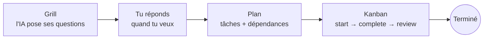

<p align="center">
  
</p>

<h1 align="center">Brigade</h1>

<p align="center">
  <strong>Le chef de brigade de tes agents IA.</strong><br />
  Gestionnaire de projet local, exposé en MCP, pensé pour Claude Code.
</p>

<p align="center">
  
  
  
  
  
  
</p>

---

Brigade donne à Claude Code une mémoire de projet qui survit aux sessions. L'IA parle à Brigade par un serveur MCP ;
toi, tu lis et tu réponds dans une interface web. Rien ne quitte ta machine : un conteneur, une base SQLite.

## Pourquoi

L'état d'une tâche dans Claude Code ne vit que le temps de la session. Brigade sépare **ce qu'on veut faire**
(spécification, vérification) de **la session qui l'exécute** : les questions, le plan et l'avancement sont stockés,
l'IA peut reprendre n'importe quand (« on continue »), et rien n'oblige à répondre sur le moment.

## Comment ça marche



1. **Grill** : l'IA dépose toutes ses questions d'un coup (`ask_questions`) et continue sans attendre.
2. **Réponses** : tu réponds dans l'interface (markdown, code, images collées avec Ctrl+V), puis tu dis « c'est répondu ».
3. **Plan** : l'IA lit les réponses (`get_answers`) et découpe le travail en tâches (`create_tasks`).
4. **Exécution** : chaque tâche prête est prise, faite par l'IA ou un sous-agent, puis éventuellement relue.

## Fonctionnalités

- **Grill asynchrone** : questions groupées, réponses en markdown avec images lisibles par les agents.
- **Kanban** : titre, description, statut, priorité, difficulté, agent assigné (optionnel), dépendances et liens vers
  des questions du grill. Les dépendances sont **imposées par le serveur** : `start_task` refuse de démarrer une tâche
  dont une dépendance n'est pas terminée (et relue si la relecture est exigée). Démarrage atomique : un seul agent peut
  prendre une tâche. Glisser-déposer dans l'interface (l'humain peut contourner).
- **Agents du projet** : définitions (nom, modèle, instructions) et mode du projet (`main` = chat courant,
  `team` = sous-agents). Brigade ne lance aucun agent : Claude Code lit la tâche (`get_task`) et transmet la définition
  à un sous-agent.
- **Skills par projet** : conventions, stack et règles durables, avec import/export `SKILL.md` dans l'interface.
- **Reprise en une requête** : `get_project_state` renvoie réglages, grills, kanban, agents et prochaines actions suggérées.
- **Multi-projets**, un seul utilisateur, sans compte.

## Lancer en local (sans Docker)

```sh
npm run install:all      # dépendances serveur + web
npm run build:all        # compile le serveur et le front
npm start                # http://127.0.0.1:3100 (UI), /mcp (MCP), /api
```

Développement : `npm run dev` (serveur, port 3100) et `npm --prefix web run dev` (Vite, port 5173, proxy `/api`).

Variables : `PORT` (3100), `HOST` (0.0.0.0), `DATA_DIR` (`./data`), `WEB_DIR` (`web/dist`),
`BRIGADE_TOKEN` (jeton Bearer du MCP, optionnel), `BRIGADE_PUBLIC_URL` (base des liens renvoyés à l'IA).
L'UI et l'API ne sont pas authentifiées : ne pas exposer le port hors de la boucle locale.

## Docker

```sh
docker compose up -d --build   # données dans le volume brigade-data
```

## Brancher Claude Code

```sh
claude mcp add --transport http brigade http://127.0.0.1:3100/mcp
```

### Skill Claude Code

Le skill `skills/brigade/SKILL.md` explique à Claude comment travailler avec Brigade (nouveau projet : grill → analyse → plan → tâches ; « on continue » : `get_project_state`). Installation (lien symbolique, le dépôt reste la source) :

```sh
mkdir -p ~/.claude/skills && ln -sfn "$PWD/skills/brigade" ~/.claude/skills/brigade
```

## Outils MCP

| Outil | Rôle |
|---|---|
| `ping` | Vérifie que Brigade répond |
| `get_project_state` | **Reprise** : réglages, grills, kanban, agents et prochaines actions suggérées, en une réponse |
| `list_projects` / `create_project` | Gérer les projets |
| `ask_questions` | Déposer un lot de questions (non bloquant) |
| `list_grills` | Avancement des grills d'un projet |
| `get_answers` | Lire un grill, réponses et images incluses |
| `get_question` | Lire une seule question (pour un sous-agent) |
| `create_tasks` | Créer un lot de tâches avec dépendances (`ref` locales) et liens vers des questions |
| `list_tasks` | Kanban d'un projet ; chaque tâche est PRÊTE ou BLOQUÉE (`ready_only`) |
| `get_task` | Fiche complète : description, résultats des dépendances, agent, questions liées avec images |
| `update_task` | Champs, assignation, dépendances, liens |
| `start_task` / `complete_task` / `review_task` / `release_task` | Cycle de vie : à faire → en cours → (relecture →) terminée |
| `list_agents` / `save_agent` | Agents du projet et leur disponibilité |
| `list_skills` / `get_skill` / `save_skill` | Skills (instructions durables) du projet ; import/export `SKILL.md` dans l'interface |
| `set_project_settings` | Mode, modèle par défaut, relecture exigée |

## Tests

`npm run smoke` : test de fumée (vrai client MCP + API) contre un serveur démarré (`BRIGADE_URL`).

## Roadmap

1. ~~Squelette + MCP + accès des sous-agents~~
2. ~~Grill~~
3. ~~Kanban (dépendances, lancement atomique, relecture)~~
4. ~~`get_project_state`, agents de projet~~
5. ~~Skills par projet~~
6. ~~Skill Claude Code « Brigade »~~
